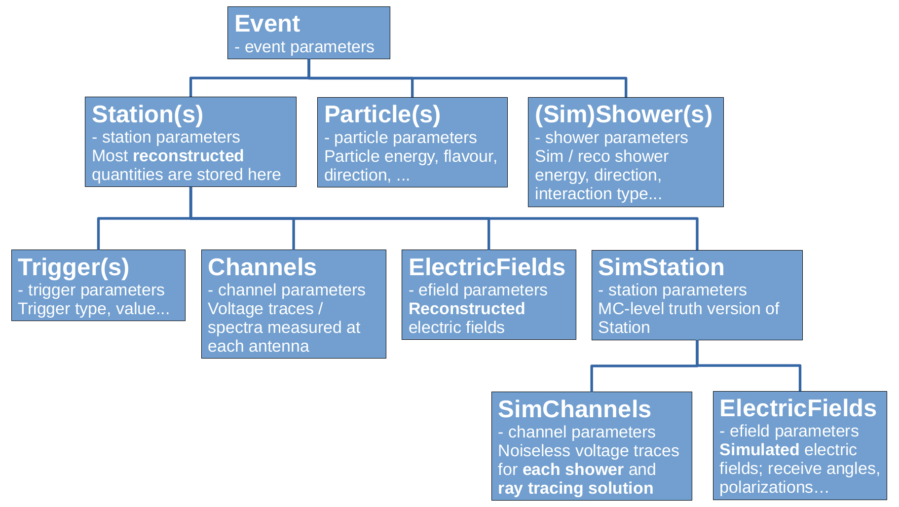

Data Structure
===========================

.. Note::

  This page explains the structure of NuRadioReco events and their files (parquet), which contain event-level data
  from simulation or reconstruction. For more information on the simpler ``.hdf5`` files produced
  in a ``NuRadioMC`` simulation, see the page on :doc:`HDF5 structure </NuRadioMC/pages/HDF5_structure>`.

Event Files and How to Use Them
----------------------------------

Philosophy and Basic Structure
__________________________________
NuRadioReco stores complete events (parameters, traces, simulated quantities) in
`parquet <https://parquet.apache.org/>`_ files. With
the obvious exception of reading in data from other file formats, like
*CoREAS* or the *SnowShovel* format of the *ARIANNA* experiment, every
processing step in an event reconstruction works on this event structure. The big
advantage this provides, is that at any point the process can be interrupted
and the current state of the event data can be saved. This makes it easy to
split a reconstruction into several steps and to check the state of the data
structure after every step.

A NuRadioReco event is organized hierarchical, with an ``Event`` object at the
top. Elements further down the hierarchy can be accessed via *get* functions or
iterators from their parent object. For example, accessing the traces of a
station's channels would work like this:

.. code-block:: Python

  #get station with ID 42
  station = event.get_station(42)
  # iterate over all channels in station
  for channel in station.iter_channels():
    trace = channel.get_trace()

Reading and Writing Event Files
________________________________

Writing events is done by the :mod:`eventWriter <NuRadioReco.modules.io.eventWriter>` module. It writes the
station file ``<name>.parquet`` (one row per event and station) and the event file ``<name>_event.parquet``
(one row per event). To save disk space it offers the option to not store channel and electric field traces,
in case only the higher-level parameters are needed. The detector description is not stored.
The files are written to temporary files and moved into place by ``end`` (or ``close``), so the output may
replace the files that were read; existing files are only replaced with ``overwrite=True``.

.. code-block:: Python

  import NuRadioReco.modules.io.eventWriter

  event_writer = NuRadioReco.modules.io.eventWriter.eventWriter()
  event_writer.begin('output_filename', overwrite=True)  # writes output_filename.parquet + output_filename_event.parquet
  event_writer.run(event)
  event_writer.end()

The :mod:`eventReader <NuRadioReco.modules.io.eventReader>` iterates over the events of one or several files,
optionally selecting stations and runs:

.. code-block:: Python

  import NuRadioReco.modules.io.eventReader
  event_reader = NuRadioReco.modules.io.eventReader.eventReader()
  event_reader.begin(['path/to/file.parquet', 'path/to/other/file.parquet'])
  # iterate over events
  for event in event_reader.run():
    station = event.get_station(42)

Every parameter is a column in the files, so it can be read for all events without building the events,
e.g. with :class:`AnalysisReader <NuRadioReco.utilities.analysis_reader.AnalysisReader>` (polars) or any other
parquet library. For example, to make a histogram of the zenith angles in a given file:

.. code-block:: Python

  import matplotlib.pyplot as plt
  from NuRadioReco.utilities import units
  from NuRadioReco.utilities.analysis_reader import AnalysisReader
  header = AnalysisReader('path/to/file.parquet', stations=[42]).read()
  zeniths = header['stationParameters.zenith'].to_numpy()
  plt.hist(zeniths / units.deg)
  plt.show()

The command line tool ``nuradio-analyse`` shows the content of the files (``nuradio-analyse --help``).
The file layout and the rules for new parameters are described in :doc:`Event Files (parquet) </NuRadioReco/pages/parquet_format>`.

The ``.nur`` format
________________________________

Older versions of NuRadioReco wrote *.nur* files, in which every object of the event was
`pickled <https://docs.python.org/3/library/pickle.html>`_. They can no longer be written. The
:mod:`eventReader <NuRadioReco.modules.io.eventReader>` still reads them (deprecated, via
:mod:`eventReaderNur <NuRadioReco.modules.io.eventReaderNur>`), as does
:class:`NuRadioRecoio <NuRadioReco.modules.io.NuRadioRecoio>`, which also provides access to single events by
ID or event number and to a detector description stored in the file
(see :ref:`Reading the detector <NuRadioReco/pages/detector/detector:Reading the detector>`).
Convert them with ``nuradio-analyse convert <files>``.

.. _label_parameter_storage:

Parameter Storage
----------------------
NuRadioReco offers a flexible way to store properties in the data structure via
parameter storage. Certain classes (``Particle``, ``Station``, ``SimStation``, ``Channel``,
``ElectricField``, ``RadioShower``, ``HybridShower`` and ``Trigger``) provide ``get_parameter``
and ``set_parameter`` functions that allow parameters to be stored in those
objects along with their uncertainties and correlation to any other parameters.
The parameters are defined in an enumerated type *enum*, so to add a new parameter,
it just needs to be added to the
:mod:`list of parameters <NuRadioReco.framework.parameters>`.

.. admonition:: For Developers

  New parameters should always be added to the bottom of the list. Do not re-use old Enums!
  A description should be added to each new parameter with a comment docstring starting with ``#:``.

Additionally, parameters can be written and accessed via indexing, like one
would do to a dictionary:

.. code-block:: Python

  from NuRadioReco.framework.parameters import stationParameters as stnp
  from NuRadioReco.utilities import units

  # both ways to set the parameter are equivalent
  station.set_parameter(stnp.cr_zenith, 45 * units.deg)
  station[stnp.cr_zenith] = 45 * units.deg
  # set parameter uncertainty
  station.set_parameter_error(stnp.cr_zenith, 2 * units.deg)
  # 2 ways of accessing parameters:
  zenith = station.get_parameter(stnp.cr_zenith)
  zenith = station[stnp.cr_zenith]
  # get parameter uncertainty
  zenith_uncertainty = station.get_parameter_error(stnp.cr_zenith)

List of Data Classes
----------------------

Event
____________
The :class:`Event <NuRadioReco.framework.event.Event>`
is the upper-most element of the event structure and holds all simulated and reconstructed
showers and stations as well as the event ID and run number.

Radio Shower
______________
A :class:`Radio Shower <NuRadioReco.framework.radio_shower.RadioShower>` is used to
hold reconstructed shower parameters via the parameter storage. It should only be
used for properties reconstructed from the radio signal, for properties from a simulated
shower or reconstructed from another detector, the SimShower or HybridShower should be
used, respectrively.

It can be accessed by the ``get_showers`` and ``get_first_shower`` methods of the :class:`Event<NuRadioReco.framework.event.Event>` class.

SimShower
____________
A Sim Shower is used to hold parameters of simulated showers via the parameter storage.
They are the same class as ``RadioShower``, but are stored separately to distinguish
between simulated and reconstructed properties.

It can be accessed by the ``get_sim_showers`` method of the :class:`Event<NuRadioReco.framework.event.Event>` class.

SimEmitter
____________
The :class:`SimEmitter<NuRadioReco.framework.sim_emitter.SimEmitter>` class is used to hold parameters of simulated emitters via the parameter storage.
The concept is similar to the SimShower, but is used when NuRadioMC is used to simulate emitters (and)
not particle showers.

It can be accessed by the ``get_sim_emitters`` method of the :class:`Event<NuRadioReco.framework.event.Event>` class.
We allow for multiple emitters per event analogous to the multiple showers per event.

Particle
________
The :class:`Particle<NuRadioReco.framework.particle>` class stores information related to the particle that initiated the radio emission, such as flavour, energy and direction. A single :ref:`Event <NuRadioReco/pages/event_structure:Event>` may contain multiple particles, e.g. in the case of tau regeneration.

Station
____________
A :class:`Station<NuRadioReco.framework.station>` is used to hold event properties
reconstructed at the station level, i.e. reconstructed from the data of a single station.

It can be accessed by the ``get_station`` and ``get_stations`` methods of the ``Event`` class

Trigger
____________
The :class:`Trigger<NuRadioReco.framework.trigger>` contains information about the station trigger - trigger type, threshold, trigger time and whether the trigger condition was satisfied.
Apart from its name and type, all values of a trigger are stored as ``triggerParameters``
(see :ref:`parameter storage <label_parameter_storage>`), e.g. ``trigger[triggerParameters.threshold]``.

SimStation
____________
A :class:`SimStation<NuRadioReco.framework.sim_station>` can hold the same
properties as the ``Station`` (and inherits from it), but is used for the MC truth  of the simulation. This
also implies that events from measured data typically do not have a ``SimStation``.

It can be accessed by the ``get_sim_station`` method of the ``Station`` class.

BaseTrace
____________
The :class:`BaseTrace<NuRadioReco.framework.base_trace>` class
is used to store waveforms, both for voltages in the channels and electric fields.
While internally traces are stored in the time
domain, where they can be accessed via the ``get_trace`` and ``set_trace`` method, it is also
possible access the waveform in the frequency domain via the ``get_frequency_spectrum``
and ``set_frequency_spectrum`` method. In that case, a Fourier transformation is
done automatically by the ``Trace``.
The times and frequencies corresponding to the waveforms returned by the ``get_trace``
and ``get_frequency_spectrum`` methods can be accessed via the ``get_times`` and
``get_frequencies`` methods. The times are defined relative to the time
of the parent ``Station`` and can be changes using the ``set_trace_start_time``
method, which changes the starting time of the trace.

The add operator (+) is defined for 2 ``BaseTrace`` objects. It will return a new ``BaseTrace``
object containing the sum of both traces. The length of the new trace is chosen so that
it is long enough to contain both traces. If the traces have different sampling rates,
the one with the lower sampling rate will be upsampled to match the other one.
Since this property is inherited, + is defined for both channels and electric fields.

The ``Trace`` class is not used by itself, but serves as parent class for both
the ``Channel`` and ``ElectricField`` classes.

Electric Field
_______________
The :class:`ElectricField<NuRadioReco.framework.electric_field>`
is used to store information about electric fields, which can be accessed via the parameter storage
and methods inherited from the ``BaseTrace`` class.

Since radio stations for neutrino detection are often so spread out that the electric field
is not the same at all channels, each electric field is associated with one or more channels,
whose IDs have to be passed to the Constructor function and can be accessed by the ``get_channel_ids``
method. Since pulses may reach a channel via different paths through the ice, multiple ``ElectricField``
objects may be associated with the same channel. Since typically multiple channels are used to
reconstruct the electric field, each ``ElectricField`` can be associated with multiple channels. To
avoid ambiguity, the ``ElectricField`` also has a position (accessed via ``get_position``) relative to
the station.

A ``Station`` ´s or ``SimStation`` ´s ``ElectricField`` objects can be accessed via the ``get_electric_fields``
method or the ``get_electric_fields_for_channels`` method, which allows to filter by channel IDs and ray path types.

Channel
____________
The :class:`Channel<NuRadioReco.framework.channel>`
is used to store information about the voltage traces recorded in a channel,
which can be accessed via the parameter storage and methods inherited from
the ``BaseTrace`` class. Optionally a ``trigger_channel`` object of the same class can
be stored within a channel object. The idea is that the voltage traces on which the trigger(s)
run can be a different from what the system reads out (additional filters may be applied to
the trigger channels). One can access the ``trigger_channel`` from a channel object via the
``get_trigger_channel()`` method. This function will always return a channel object. If no
trigger channel was defined, ``self``, i.e., the channel object itself, is returned.
The :class:`Station<NuRadioReco.framework.station>` class also has a method to return trigger channels
(if defined). Trigger modules should typically call these ``get_trigger_channel()`` methods to
get the channel objects.

Hybrid Information
___________________
As many radio detectors are built as part of a hybrid detector whose data may be used in the
radio event reconstruction, a way to make this data accessible in NuRadioReco is needed. The
:class:`HybridInformation<NuRadioReco.framework.hybrid_information>`
class provides this functionality and sections the information from the
other detectors off from the radio part to avoid confusion. Despite its name, it does not
hold any data from the other detectors itself, but offers access to ``HybridShower`` objects in
which this data is stored. For each additional detector (or set of detector data), a ``HybridSHower``
object can be added via the ``add_hybrid_shower`` method or accessed via the ``get_hybrid_shower``
or ``get_hybrid_showers`` methods.

It can be accessed via the ``get_hybrid_information'' method of the ``Event`` class.

Hybrid Shower
______________
The :class:`HybridShower<NuRadioReco.framework.hybrid_shower>` is
used to store information about a shower that was reconstructed with a complementary detector,
mainly via the parameter storage.

It can be accessed via the ``get_hybrid_shower`` and ``get_hybrid_showers`` methods of the
``HybridInformation`` class.

Hybrid Detector
_________________
A ``HybridDetector`` can be used to store more detailed and experiment-specific information
about a complementary detector. The diversity of hybrid radio detectors makes it
impractical to provide this functionality inside NuRadioReco itself, but a custom
``HybridDetector`` class can be implemented inside an independent repository. This class
can be slotted into the data structure via the ``set_hybrid_detector`` method of the ``HybridShower``
class and accessed via its ``get_hybrid_detector`` method.

A ``HybridDetector`` class is required to have a constructor that does not accept any parameters as
well as a ``serialize`` and a ``deserialize`` function equivalent to the other framework elements.

An example for the implementation of a custom ``HybridDetector`` can be found in the
NuRadioReco/example folder.
